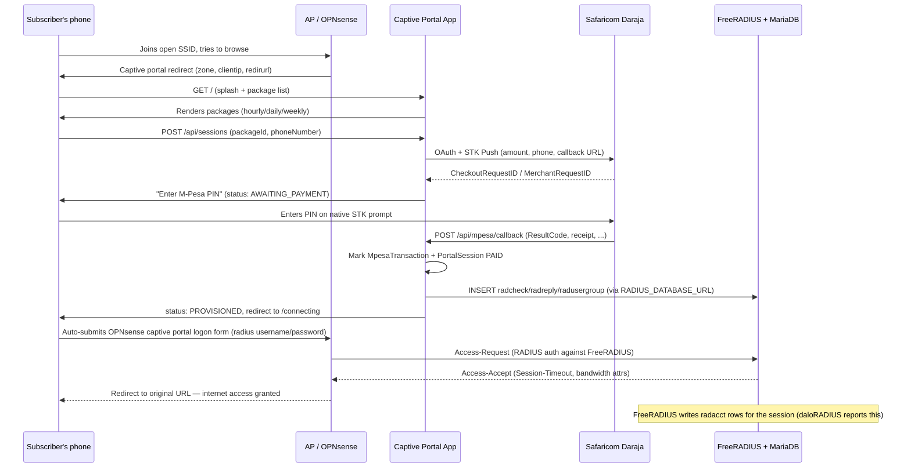

# Architecture

## Components

| Component | Role | Owned by |
|---|---|---|
| AP(s) | Broadcast open SSID, bridge clients to the gateway VLAN | ISP infra |
| OPNsense | Router/firewall, Captive Portal zone, DHCP/DNS for the hotspot VLAN | ISP infra |
| FreeRADIUS 3.x | AAA server backing OPNsense's captive portal | ISP infra (installed per the daloRADIUS guide) |
| daloRADIUS | Staff UI over the FreeRADIUS schema: NAS management, operator accounts, usage/billing reports | ISP infra, unmodified |
| **This app** | Customer-facing splash page, package selection, M-Pesa STK Push, RADIUS provisioning, auto-login against OPNsense | This repo |
| MariaDB | Shared schema: `radcheck`, `radreply`, `radusergroup`, `radacct`, `nas` (+ daloRADIUS's own tables) | ISP infra, schema owned by daloRADIUS's SQL migrations |
| Postgres | This app's own data: packages, sessions, M-Pesa transactions, provisioning logs | This repo |
| Safaricom Daraja | M-Pesa STK Push + callback | External |

## End-to-end flow

## Key design decisions

1. **The captive portal splash page is this app, not OPNsense's built-in template.** OPNsense's portal page template is reduced to a near-blank page that immediately redirects the client's browser to this app's URL, carrying OPNsense's template variables (`$zoneid`, `$clientip`, `$redirurl`) as query params. This keeps the portal UI, package catalog and payment flow in one codebase instead of PHP templates inside OPNsense. See [`OPNSENSE-SETUP.md`](OPNSENSE-SETUP.md).

2. **Auth still happens through OPNsense + FreeRADIUS, not by bypassing them.** This app never opens a firewall hole itself. It provisions a RADIUS user and then logs the client in through OPNsense's own captive portal logon endpoint — the exact mechanism an ISP staff member would use, just automated. This keeps daloRADIUS's accounting (`radacct`), session limits and NAS-level controls intact.

3. **Two databases, two Prisma schemas.** This app's own business data (packages, payment state, audit log) doesn't belong in a schema owned by daloRADIUS's migrations, and the RADIUS schema shouldn't be migrated by us. See [`RADIUS-INTEGRATION.md`](RADIUS-INTEGRATION.md) for the split and why it's still "simple" enough for Prisma over Drizzle.

4. **RADIUS username = phone number (stable); password is short-lived and single-use.** The username stays the same across a subscriber's visits on purpose — it's what lets daloRADIUS's `radacct` history and reports recognize a returning subscriber (see [`RADIUS-INTEGRATION.md`](RADIUS-INTEGRATION.md#tracking-returning-subscribers)). Only the password rotates on every paid session, with `Session-Timeout` capping that session to the package duration, and a scheduled cleanup job removing the `radcheck`/`radreply` rows once a session expires so a lapsed password can't be replayed. See [`RADIUS-INTEGRATION.md`](RADIUS-INTEGRATION.md#cleanup).

5. **OPNsense is the RADIUS NAS client, with accounting on.** OPNsense's captive portal zone authenticates against FreeRADIUS (ports 1812/1813) using a shared secret that matches a `nas` row added in daloRADIUS for OPNsense's portal-interface IP. Accounting must be enabled on that zone — it's what populates `radacct`, which the app needs to know when a package's session actually started (see [`RADIUS-INTEGRATION.md`](RADIUS-INTEGRATION.md#radacct-and-package-expiry)), not just when payment cleared.

6. **Package expiry starts passive, with active cutoff as an explicit v2.** `Session-Timeout`/`Expiration` on the `radcheck`/`radreply` rows plus the cleanup job is the v1 enforcement. RADIUS CoA/Disconnect-Request (OPNsense supports it) for an immediate hard cutoff is a deliberate later addition, not a gap — see [`RADIUS-INTEGRATION.md`](RADIUS-INTEGRATION.md#enforcing-expiry-passive-vs-active-open-design-question) for the tradeoff.

7. **The callback endpoint must be public HTTPS.** Safaricom calls `CallBackURL` directly from Safaricom's servers — this app must be reachable from the internet over HTTPS (real certificate, not self-signed). For an on-prem WISP box this usually means a reverse tunnel (e.g. Cloudflare Tunnel) or hosting the app off-site and having OPNsense's redirect point at the public URL while the RADIUS provisioning call reaches back into the LAN (VPN/tunnel) to the MariaDB box. This is an infra decision to make explicit before build — see "Open questions" below.

8. **No STK Push callback is fully trusted on its own.** Safaricom's callback delivery isn't 100% reliable. The app also supports an STK Push **status query** (`/mpesa/stkpushquery/v1/query`) as a fallback poll if no callback arrives within a timeout, so a payment that actually succeeded doesn't strand the subscriber on the waiting screen.

## Open questions (infra, not app code)

- **Network topology**: is this app hosted on the same LAN as OPNsense/FreeRADIUS (so it can reach the MariaDB box directly and just needs outbound internet for Safaricom + a port-forward/tunnel for the callback), or hosted off-site with a VPN/tunnel back to the LAN? This determines `RADIUS_DATABASE_URL` reachability and the callback URL setup.
- **Single AP/NAS today, but how many eventually?** If more than one site/NAS is likely, package pricing or bandwidth caps per-NAS may matter later — the `Package` model below doesn't scope by NAS yet, add a `nasId` column when that's real.
- **Daraja production go-live**: sandbox is immediate; production (Till/Paybill shortcode, production consumer key/secret, passkey) requires a Safaricom merchant application — plan for building and testing against sandbox first.
